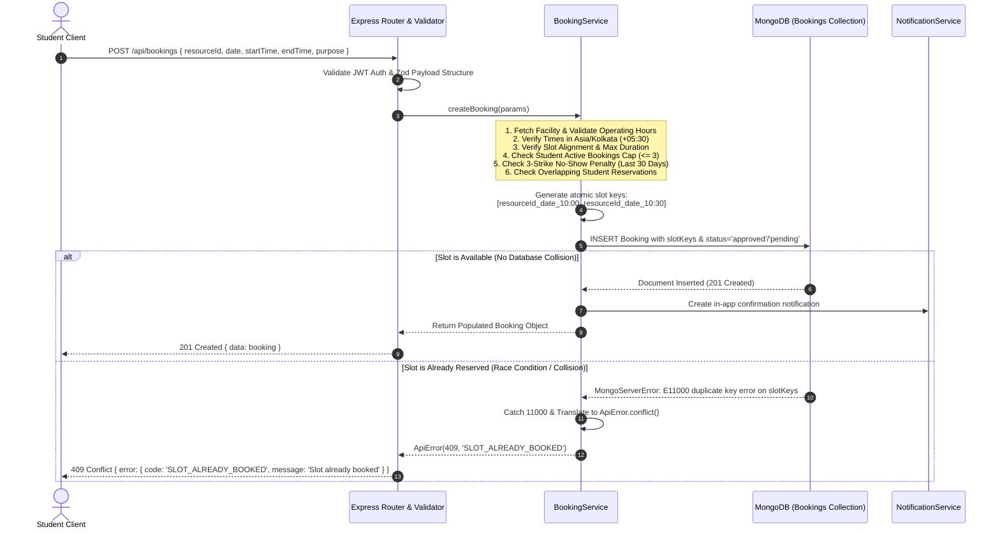
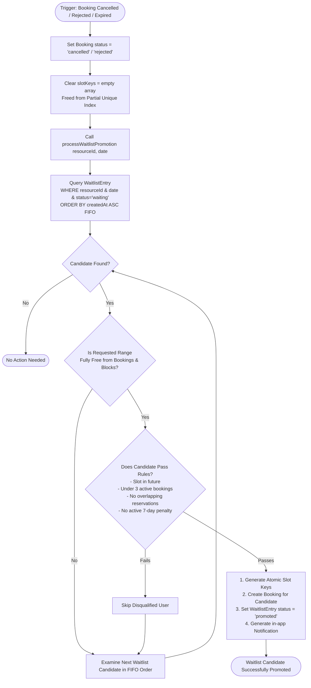
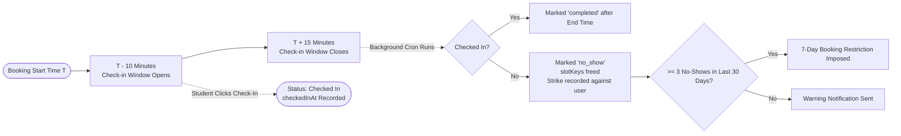
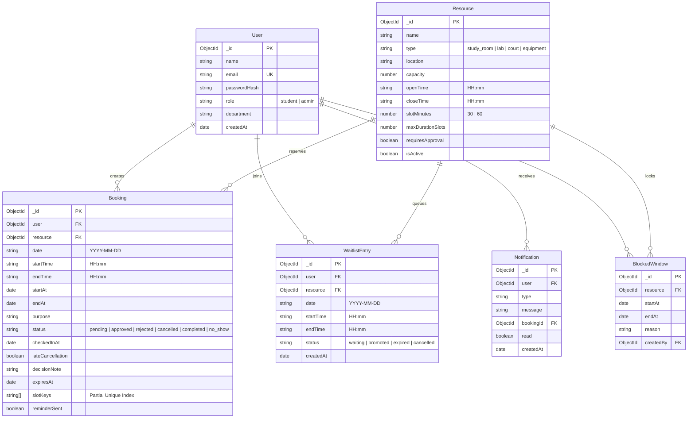

# CampusSlot - Architecture & Engineering Design

This document details the software architecture, concurrency mechanics, data flow pipelines, and technical trade-offs implemented in **CampusSlot**.

---

## 1. System Architecture Overview

CampusSlot follows a decoupled, three-tier modular architecture designed for high cohesion, low coupling, and verifiable unit/integration testability.

```mermaid
graph TD
    Client["React 18 + Vite SPA (Client)<br/>Tailwind CSS • Recharts • Axios"]
    
    subgraph ExpressApp ["Node 20 / Express Server (/server)"]
        Security["Security Layer<br/>Helmet • CORS • Rate Limiting"]
        Routes["API Routing Layer (/api/*)<br/>Zod Schemas • Auth Middleware"]
        Controllers["Thin Controllers<br/>HTTP Request/Response Mapping"]
        Services["Domain Services (Business Engine)<br/>Booking • Waitlist • Analytics"]
        Jobs["Background Cron Jobs (node-cron)<br/>No-show • Expiration • Reminders"]
    end

    subgraph DataStore ["Database Tier"]
        MongoDB[(MongoDB Atlas / MongoMemoryServer)<br/>Partial Unique Indexes • BSON Models]
    end

    Client -->|HTTPS / REST API| Security
    Security --> Routes
    Routes --> Controllers
    Controllers --> Services
    Jobs --> Services
    Services --> MongoDB
```

---

## 2. Core Workflows & Sequence Diagrams

### Workflow 1: Atomic Booking Creation & Concurrency Control

Preventing double bookings under high concurrent load is guaranteed at the database constraint level using atomic `slotKeys` combined with MongoDB partial unique indexes.



---

### Workflow 2: Automated FIFO Waitlist Promotion Engine

When an active booking is cancelled by a student, rejected by faculty, or auto-expired by the background cron job, the slot keys are cleared and the oldest eligible waitlisted candidate is automatically promoted.



---

### Workflow 3: Check-in Window Enforcement & No-Show Strike Policy



---

## 3. Database Schema & Indexing Strategy



### Critical Partial Unique Index Definition
```javascript
bookingSchema.index(
  { slotKeys: 1 },
  {
    unique: true,
    partialFilterExpression: {
      status: { $in: ['pending', 'approved'] },
    },
  }
);
```
- **Why it matters**: MongoDB enforces uniqueness across any active reservation slot. When a reservation is cancelled, rejected, completed, or marked as a no-show, `slotKeys` is reset to `[]`, immediately freeing the slot for other students or waitlist candidates without deleting historical records.
